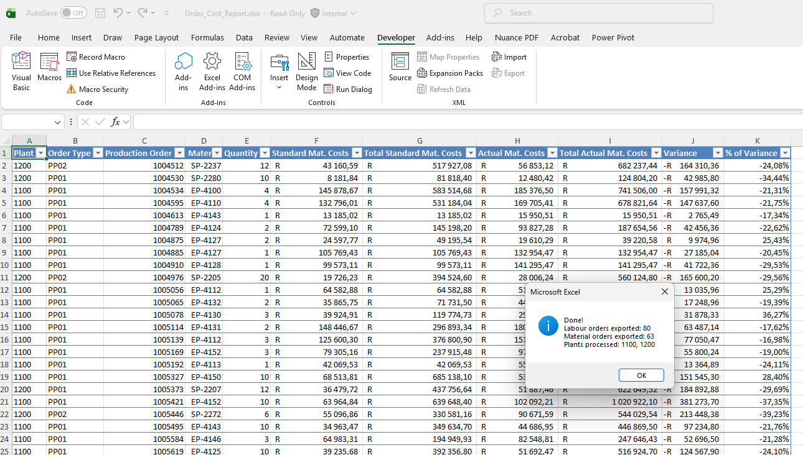
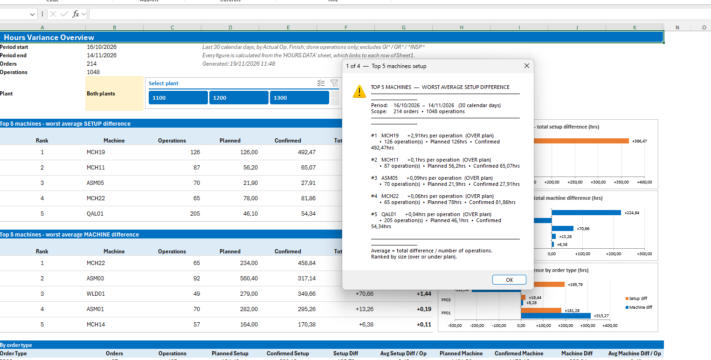
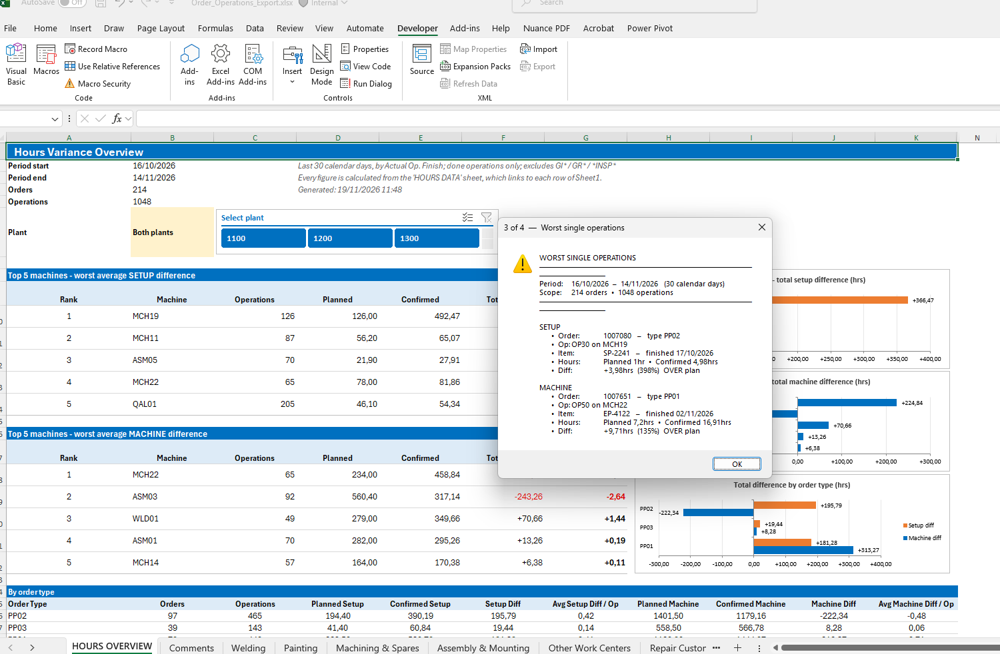
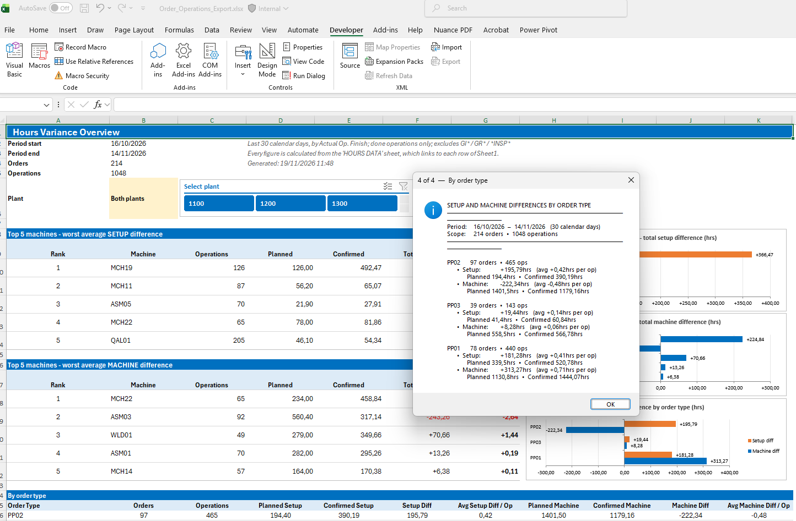

# 01: Production Variances (labour, material and hours)

## The problem
Every month, hundreds of production orders close with actual labour and material costs that differ from standard. Management needs to know which orders matter, and the workshop and Industrial Engineering need to know **which operation on which machine** caused the difference, so they can comment and fix standards. Done by hand, this means scanning a 3-row-per-order cost report, then digging through thousands of operation lines.

## What I built: a two-stage process

**Stage 1: `modVarianceFlags` → `GroupFilterAndExport`**
*Input:* `data/Order_Cost_Report.xlsx` (3-row block per order, numbers as ERP text)
- Groups each order block, then flags labour outside **±45 %** and material outside **±20 %**
- Picks up plants from the data (no hard-coding) and finds the order type column by itself
- Builds **Labour Raw Data** (table with formulas and a totals row), a hidden **Labour Pivot Summary**, **Labour Comments** pre-filled in the layout the workshop answers in, and **Material Raw Data**

**Stage 2: `modHoursVarianceReview` → `BuildHoursSummaryWeekly` / `BuildHoursSummaryMonthly`**
*Input:* `data/Order_Operations_Export.xlsx` (one row per operation, sheet `Sheet1`)
- Compares **planned vs confirmed** setup and machine hours on every operation, ignoring goods issue / goods receipt / inspection lines
- Shows a line in **red** when it is over plan by ≥ 2 h (machine), ≥ 1 h (setup), or ≥ 50 %
- **Comments**: one row per order, newest first, with each operation on its own line
- **Department tabs** (Machining, Assembly, Welding, Painting, Other), plus service-workshop tabs by repair type
- **Favourable Variances**: operations that beat the plan, with large ones highlighted
- **Remarks are kept**: comments typed by the workshop survive a re-run
- **HOURS OVERVIEW**: a **plant slicer** drives live Top 5 machine tables, Top 10 operations, and order type and machine tables, all built from `LET / FILTER / SORTBY` formulas, plus three charts. Every figure traces back to its export row through the hidden **HOURS DATA** sheet.
- Pop-ups summarise the period: worst machines for setup and machine time, the worst single operations, and results by order type
- **Weekly** uses the last 14 working days (Mon–Sat). **Monthly** uses the last 30 calendar days. Both run the same module.

**Time saved:** a whole day of compiling across three plants now takes about 10 minutes of the code running.

## Expected results on the demo data
| Stage | Result |
|---|---|
| 1 | **80** labour orders and **63** material orders exported |
| 2 | Top setup machine: **MCH19** (setups run 2–4 h over plan, so it needs a proper setup standard) |
| 2 | **MCH22** machine time over plan after mid-October (new CNC machine, operators training) |
| 2 | **ASM03** fills the Favourable Variances sheet (consistently under plan) |
| 2 | Plant **1300** jobs land on the service tabs (Repair Customer Pump, Rewind Motor, Claim Repair, Commissioning) |

## After
Results on the demo data: **80** labour and **63** material orders (stage 1). Stage 2, monthly window: **214** orders, **1 048** operations. **MCH19** is the worst setup machine at +2.9 h per operation, **MCH22** the worst machine-time centre at +3.5 h per operation, and **ASM03** fills the Favourable Variances sheet (140 operations).

Output workbooks: `output/Order_Cost_Report_output.xlsm`, `output/Order_Operations_Export_output.xlsm`

*All data is fictional.*
