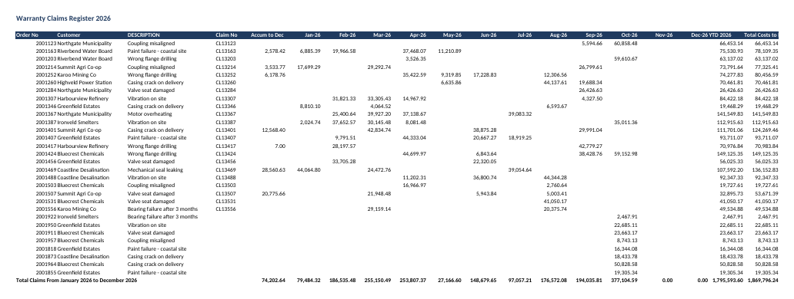

# 02: Warranty & Goodwill Claims

## The problem
Every month, the claims costs export comes out of SAP in a grouped outline view. Order details sit only on the first line of each order, the "blank" cells are really empty text, and subtotals are mixed in with detail lines. Each order then has to be posted into a year-to-date register: warranty claims and goodwill go to separate ledgers, existing orders get the new month's amount, new orders are added, and the totals, YTD and graph have to stay right.

## What I built: two steps

**Step 1: `modClaimsExport` → `RunAll`**
*Input:* `data/Claims_Export_Oct2026.xlsx`, sheet **RAW DATA**
- Classifies every row as detail, order subtotal or grand total **before** touching anything, so nothing is lost
- Fills the outline blanks downwards with a cell-by-cell loop. `SpecialCells(xlCellTypeBlanks)` misses empty-text cells, so it can't be used.
- Collapses the export to the grouped view and builds a **Claims Summary**: one line per order, with a live TOTAL
- Leaves the claim number column for capture. In the demo, the numbers are on the **Claim No lookup** sheet.

**Step 2: `modClaimsLedger` → `FeedMonthlyDataToLedgers`**
*Input:* the summary sheet, renamed **October 2026** and moved into `data/Claims_and_Goodwill_2026.xlsx`
- Finds the month column **from the sheet name** and matches it against the date headers, so no column is hard-coded
- Warranty orders (**WA01**) go to **CLAIMS 2026** and goodwill orders (**GW01**) to **GOODWILL 2026**
- Existing orders get the month's amount, and blank claim numbers are filled in. New orders use a spare row first, or are inserted **above the Total row**.
- Rebuilds the YTD, Total-Costs-to-Date and Total-row formulas so they cover every row
- Moves the **GRAPH** sheet's current-month cells to the new month
- **Safe to re-run:** running the same month again replaces the amounts instead of doubling them

**Time saved:** about 4 hours of compiling each month now takes 5 minutes of the code running.

## Expected results on the demo data
- Claims Summary: **18 orders**, TOTAL **R566,068.68**
- Ledger pop-up: **CLAIMS 2026: 4 updated, 8 new** · **GOODWILL 2026: 2 updated, 4 new**
- Running it a second time for October changes nothing

## After
Results on the demo data: Claims Summary **18 orders, R566 068.68**. CLAIMS 2026 went from 22 to **30** orders (4 updated, 8 new) and GOODWILL 2026 from 9 to **13** (2 updated, 4 new). The October totals (R377 104.59 + R188 964.09) agree to the export, and the GRAPH cells moved to October.

Output workbooks: `output/Claims_Export_Oct2026_output.xlsm`, `output/Claims_and_Goodwill_2026_output.xlsm`

*All data is fictional.*
