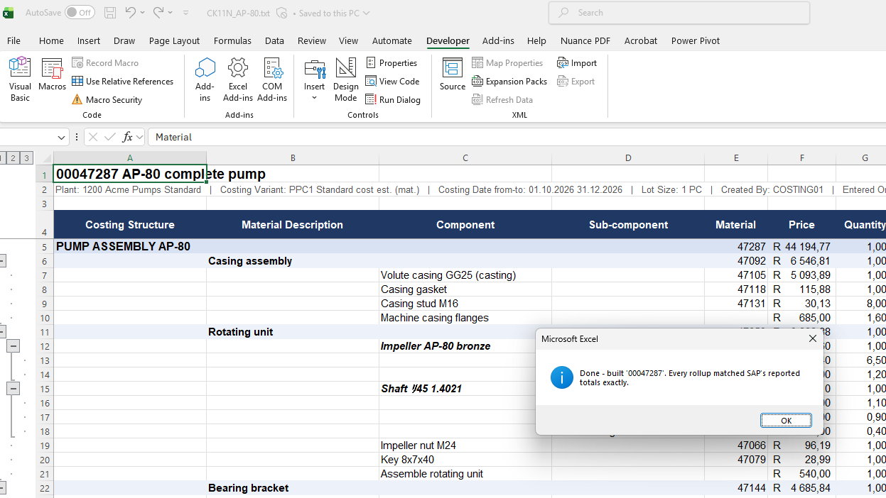

# 03: Costed BOM from CK11N

## The problem
A CK11N cost estimate (with quantity structure) export is hard to work with. The hierarchy is shown only by which column the description starts in, every line has a fixed block of 11 or 13 cost fields at the end, and the numbers are text in SAP format (`44 194,77`). Product costing, pricing and "why did this cost move?" questions all need it as a clean, structured sheet.

## What I built: `modCostedBomBuilder` → `BuildFormattedBom`
*Input:* `data/CK11N_AP-80.txt` (also MS-4 and SL-150). Open the .txt in Excel, which splits it on tabs.
- Reads the header block (material, plant, costing variant, dates, lot size) into a title
- Works out each line's **depth** from where its description starts. The trailing cost fields are read **from the end of the row**, so it works for BOMs of any depth.
- Tells activity lines (work centre + activity type) apart from material lines
- Writes **live formulas**: a parent is `=SUM(its direct children)` and a leaf is `=Price*Quantity`, across all 8 cost-component columns
- **Validates every rollup against SAP's own totals.** Differences are listed in the Immediate window. Usually they come from setup-time rounding.
- Colours each level, groups rows into **+/- outlines** (parent above children) and freezes the header
- Parses numbers in any regional format (`1 234,56`, `1,234.56`, `1234,56`)

## Expected results on the demo data
| File | Total value | Message |
|---|---|---|
| CK11N_AP-80.txt | **R44,194.77** | "Every rollup matched SAP's reported totals exactly." |
| CK11N_MS-4.txt | **R68,551.01** | same |
| CK11N_SL-150.txt | **R110,905.59** | same |

The new sheet is named after the material number.

## After
Results on the demo data: AP-80 **R44 194.77**, MS-4 **R68 551.01** and SL-150 **R110 905.59**, and every rollup matched SAP's totals.

Output workbooks: `output/CK11N_*_output.xlsm`

*All data is fictional.*
