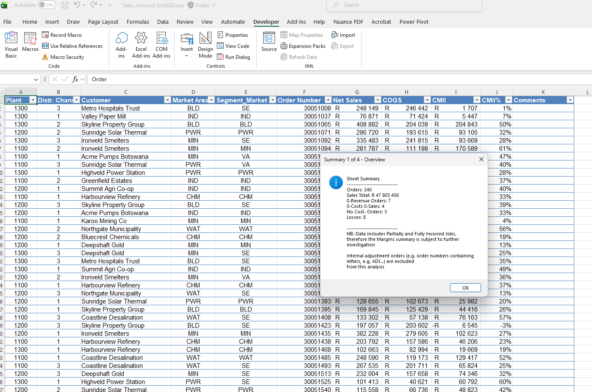
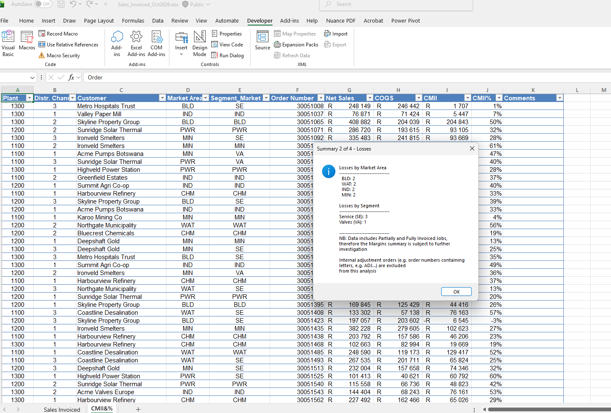
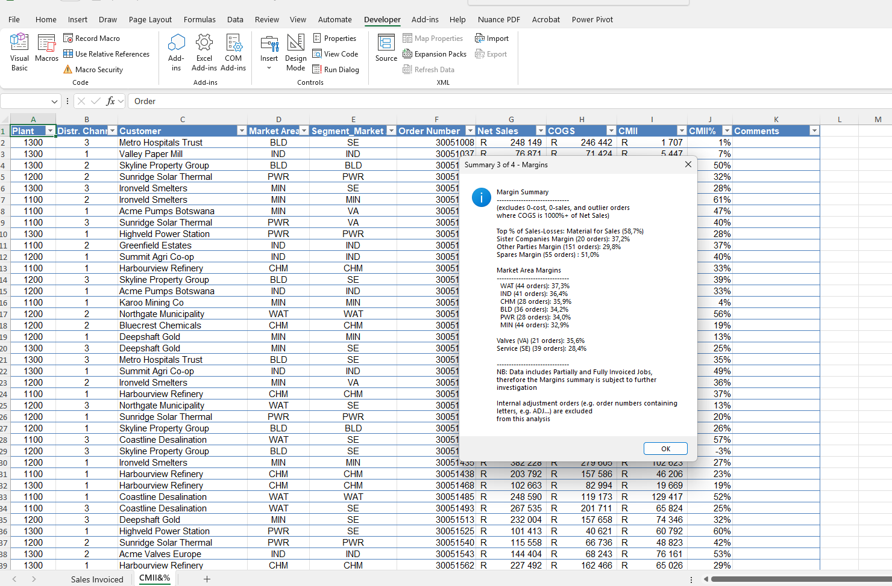
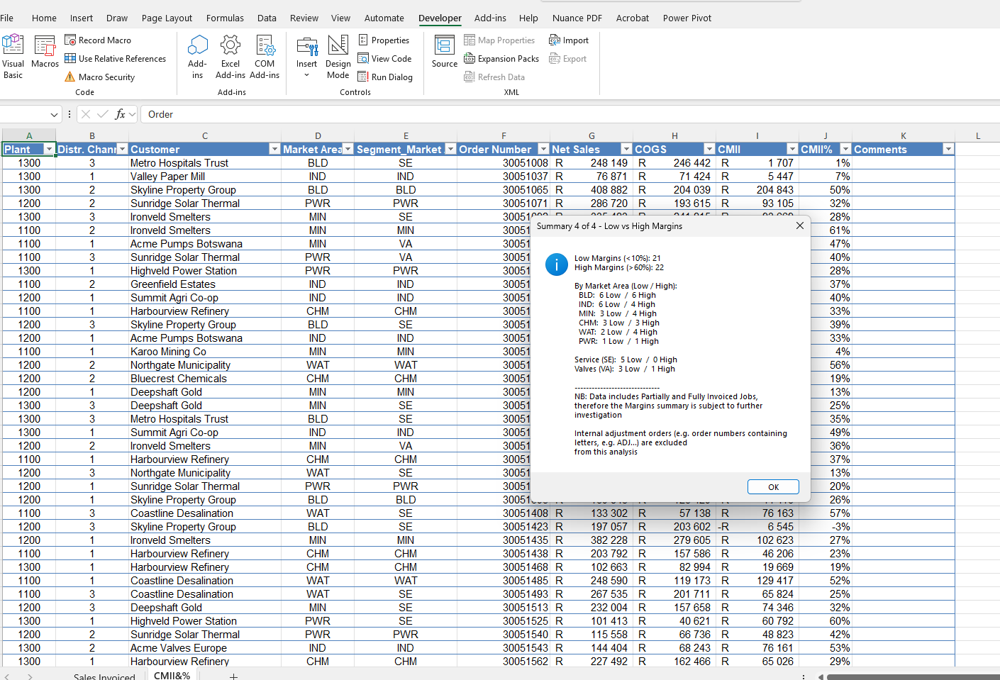
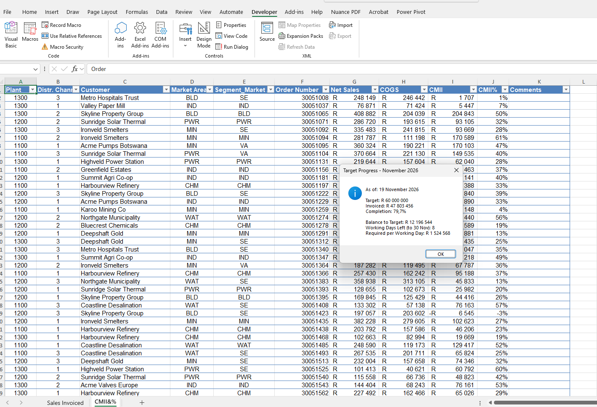

# 04: Invoiced Sales Margin (CMII)

## The problem
Each month, management wants to know: which orders made a loss, which market areas and segments are under pressure, how group-company and spares margins compare, and whether invoicing is on track for the month's target. The invoiced sales export has several detail lines per order and nine cost columns. On top of that, partial invoicing creates huge fake losses that distort every average.

## What I built: `modSalesMargin` → `CreateCMIISheet`
*Input:* `data/Sales_Invoiced_Oct2026.xlsx` (grouped view: detail lines plus one total line per order)
- Finds each order's **total line** (the plant cell is blank only there) **before** filling blanks, then fills plant, segment, market area, channel and customer down
- Builds **CMII&%**: one row per order with Net Sales, **COGS (sum of the 9 cost lines)**, CMII and CMII %, as a table with a SUBTOTAL total row
- **Excludes** internal adjustment orders (order numbers with letters)
- Leaves out **outliers** where COGS is 1000 %+ of sales (usually partial invoicing) from every margin average, but keeps them in the table
- Counts orders with zero revenue, zero cost, or both, separately
- **Five pop-ups** (also saved to a hidden **Summary** sheet with charts):
  1. Overview: orders, sales, zero-revenue and no-cost orders, losses
  2. Losses by market area and by segment (Service / Valves)
  3. Margins: the cost line that drives losses most, group companies vs other parties vs spares, by market area and segment
  4. Low (< 10 %) and high (> 60 %) margins by market area
  5. **Target progress**: invoiced vs the monthly target, balance, working days left and **rand needed per working day**. This is skipped if the data spans more than one month.

**Time saved:** about 2 hours per market area now takes 10 minutes of the code running.

## Expected results on the demo data
- **240 orders** (2 internal adjustments excluded), sales **R47,803,456**
- **8** losses · **7** zero-revenue orders · **4** zero-cost-and-zero-sales orders · **3** no-cost orders

## After
Results on the demo data: **240 orders**, R47 803 456 invoiced, 8 losses, 7 zero-revenue, 4 zero-cost-and-sales and 3 no-cost orders. Target progress: **79.7 %** of the R60m target, with R1.52m needed per working day.

Output workbook: `output/Sales_Invoiced_Oct2026_output.xlsm`

*All data is fictional, including the monthly target.*
