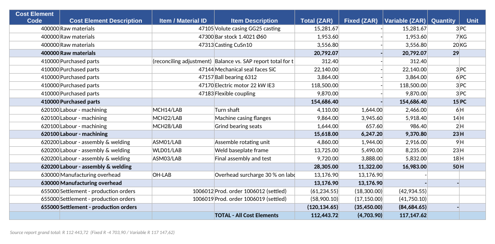

# 05: Sales Order Cost Breakdown (Actual Cost Elements)

## The problem
When a sales order's cost looks wrong, the answer is in the "actual costs, expanded view" report: every cost element with its materials, activities and settlement credits. As a text export, it's hard to read. Element totals sit *below* their lines, IDs and descriptions share one cell, credits carry a trailing minus, quantities and units are mixed together ("14,4 H"), and some element totals include lines the report doesn't show.

## What I built: `modCostElementBreakdown` → `BuildCostBreakdownComplete`
*Input:* `data/Actual_Costs_SO30051877.txt` (open in Excel, which splits it on tabs)
- Finds where the data starts on its own, and skips the report's header lines
- Collects each element's lines and closes the block when the element total (`*`) arrives. The `**` line is read as the grand total.
- Splits item ID from description, parses `1 234,56-` style numbers, and separates quantity from unit
- **Reconciles each element:** if the reported total is more than its visible lines, the difference is added as a **(reconciling adjustment)** line, so nothing goes missing
- Builds a **Detail** sheet: lines grouped under each element with SUM subtotals, a grand total, and the report's own total underneath as a check

**Note:** cost elements don't always mean the same thing from one order to the next, so the output is where the analysis starts, not the answer.

**Time saved:** a sales order cost breakdown is ready for whoever requested it in about 3 minutes, instead of 30.

## Expected results on the demo data
- **6 cost elements** processed
- **Purchased parts (410000)** gets a reconciling adjustment of **R312.40**
- Settlement element (655000) shows the production order credits as negatives
- The grand total matches the source report: **R112,443.72**

## After
Results on the demo data: 6 cost elements, a **R312.40** reconciling adjustment on Purchased parts, and a grand total of **R112 443.72**, which agrees to the source report.

Output workbook: `output/Actual_Costs_SO30051877_output.xlsm`

*All data is fictional.*
